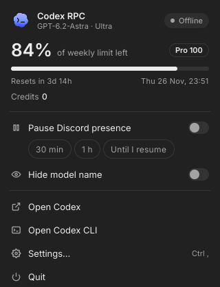
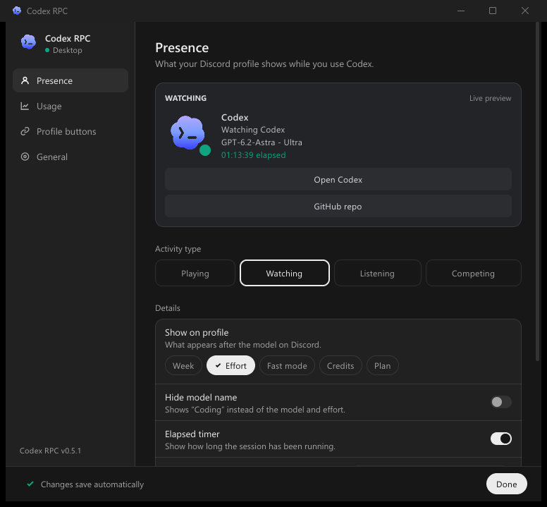
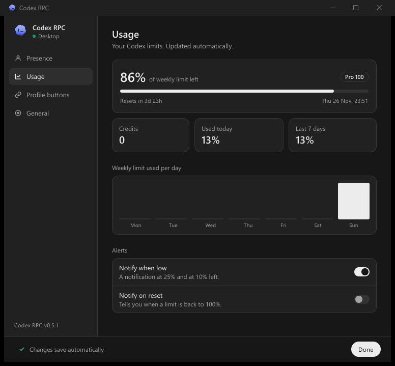

# Codex RPC

Codex RPC shows local Codex activity and account usage in a Windows or macOS tray app and sends the activity to Discord Rich Presence. It supports Codex CLI and Codex Desktop.

## Requirements

- Windows or macOS with a running Discord desktop client.
- Windows source builds: Node.js 22, Rust/Cargo, Visual Studio 2022 Build Tools with MSVC v143, and the Windows SDK. The installer also needs NSIS (`makensis`).
- macOS source builds: Node.js 22, Rust/Cargo, and Xcode Command Line Tools.
- TODO: Document the minimum supported Windows, macOS, and Rust versions.

## Install

Download the installer for your platform from [GitHub Releases](https://github.com/inerthel-agi/codex-rpc/releases/latest), then run it. The Windows release also provides a portable executable.

To build from source on Windows or macOS:

```powershell
npm run build
```

The Windows build places the portable executable at `bin/codex-rich-presence.exe` and the installer under `src-tauri/target/release/bundle/nsis/`. Without NSIS it builds the executable only. The macOS build creates an app bundle and DMG under `src-tauri/target/release/bundle/`.

Run the unit tests with:

```powershell
npm test
```

## Usage

Start Codex RPC from the installer or launch the portable Windows build:

```powershell
.\bin\codex-rich-presence.exe
```

The app starts in the system tray. Left-click its icon to open settings. Right-click it to open the tray panel on Windows, or the tray menu on macOS. Launching it again while it runs opens the settings window. To open the settings window at launch:

```powershell
.\bin\codex-rich-presence.exe --settings
```

### Tray panel



- The header shows the current model and the Codex source (Desktop, CLI, or both), or Offline, Paused or Idle.
- The usage block shows the most constrained limit, the plan, and when the limit resets. The line under it lists the other limits and the credits. A warning appears at 25% and at 10% left.
- **Pause Discord presence** hides the activity for 30 minutes, 1 hour, or until you resume it.
- **Hide model name** replaces the model and effort with `Coding` on Discord and hides the project name.
- **Open Codex** starts Codex Desktop. **Open Codex CLI** opens Command Prompt in your home folder, or Terminal on macOS, and runs `codex`. **Settings…** also opens with `Ctrl+,`.
- The bottom line shows the Discord connection, with **Reconnect** or **Resume** when one is needed.
- The panel docks 12 px from the taskbar, also when the icon is in the hidden-icons flyout. `Escape` or a click elsewhere closes it.
- On macOS the icon opens a native menu with the same entries.
- The tray icon turns grey when Codex is off and shows a dot when the presence is paused or a limit is low.

### Settings



**Presence** previews the Discord card as it will appear. The second line names the folder of the Codex thread you last worked in, unless **Hide model name** is on. The page sets the activity type, the details shown after the model (5-hour and weekly limits, effort, Fast mode, credits, plan), the elapsed timer, clearing the presence after 15, 30, or 60 idle minutes, and an optional custom status line. The custom line accepts `{model}`, `{effort}`, `{speed}`, `{5h}`, `{week}`, `{credits}`, `{plan}`, and `{project}`.



**Usage** shows each limit with its reset time, the remaining credits, usage today and over the last 7 days, and a daily chart. The history is stored locally. It also turns on system notifications when a limit drops to 25% and 10%, or when it resets.

**Profile buttons** holds up to two links. Discord shows them only in Watching mode, and other people see them only if you have Discord Nitro. **General** sets the theme (Dark, OLED with pure black backgrounds, System, or Light), start at login, and the daily update check. It also reconnects Discord and opens the data folder.

Codex RPC shows the weekly allowance for Pro subscriptions and both 5-hour and weekly allowances for Plus when Codex reports those limits. The plan badge reads `API key / unknown` when Codex reports no subscription.

## Configuration

The settings window saves every option above. Settings are stored in `%LOCALAPPDATA%\codex-rich-presence\rpc-buttons.json` on Windows and `~/Library/Application Support/codex-rich-presence/rpc-buttons.json` on macOS. The theme is stored next to it in `theme.txt`.

| Variable or flag | Type | Default | Effect |
| --- | --- | --- | --- |
| `--settings` | flag | off | Opens the settings window at launch. |
| `DISCORD_CLIENT_ID` | string | Bundled Discord application ID | Overrides the Discord application ID. |
| `SCAN_INTERVAL_MS` | integer, milliseconds | `5000` | Process scan interval; minimum `2000`. |
| `IDLE_GRACE_MS` | integer, milliseconds | `10000` | Delay before clearing activity after Codex exits. |

## Limitations

- Discord must be running for Rich Presence to appear.
- The macOS build is untested since the interface moved from a web view to Slint.
- The macOS app is ad-hoc signed and is not notarized. If Gatekeeper blocks the download, clear its quarantine attribute with `xattr -cr "/Applications/Codex RPC.app"` after reviewing the app.
- On Windows 10 the title bar only switches between light and dark; Windows 11 gives it the theme's colour. The macOS tray menu follows the system theme.
- Usage windows other than 5 hours and one week are not displayed.

## License

MIT. See [LICENSE](LICENSE).

The interface embeds the [Geist](https://github.com/vercel/geist-font) font under the SIL Open Font License 1.1; see [`src-tauri/ui/fonts/OFL.txt`](src-tauri/ui/fonts/OFL.txt).

The interface uses [Slint](https://slint.dev) under the Slint Royalty-free Desktop, Mobile, and Web Applications License 2.0. This badge is the attribution that license requires:

[](https://slint.dev)
